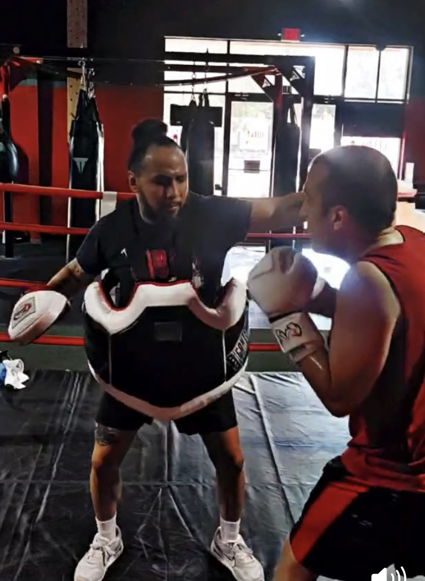
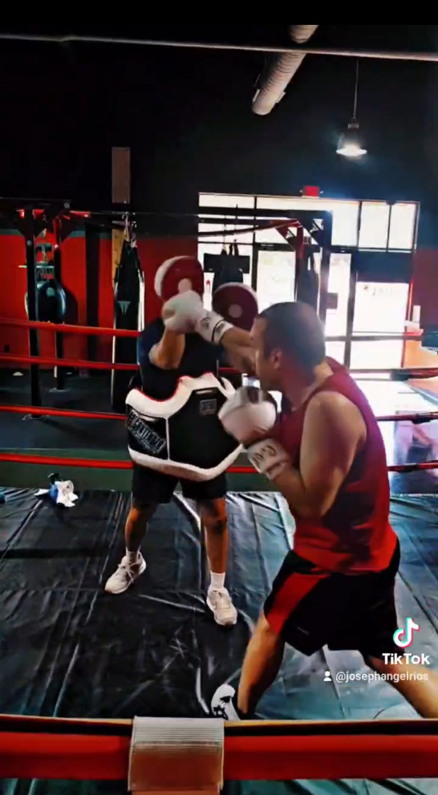

# Keep Your Hands Up.

Here's an update on my boxing progress. I did some light sparring,  Rico pointed out that I sometimes drop my non-busy hand during combinations. I've been trying to be cognizant of this during training, but we caught it on video! Keeps me honest. Going to exaggerate keeping my guard tight (phone booth), when throwing.

  

    <iframe
      src="https://www.youtube.com/embed/EVfDIfK7zYw"
      title="Boxing training 1"
      style="width: 100%; height: 100%; border: 0;"
      allowfullscreen>
    </iframe>
  

  

    <iframe
      src="https://www.youtube.com/embed/3_sYCw4k3uU"
      title="Boxing training 2"
      style="width: 100%; height: 100%; border: 0;"
      allowfullscreen>
    </iframe>
  

Did you catch it?

     
## Sometimes Things Go Well.

  <iframe
    src="https://www.youtube.com/embed/VNmev3vBrVk"
    title="Boxing sparring session"
    style="width: 100%; height: 100%; border: 0;"
    allowfullscreen>
  </iframe>

From a few weeks ago. This wasn't a completely fair fight. I was fresh, and he had just done a grueling workout. But I was still proud of myself. I landed a couple of overhands. In the moment I thought I was losing but I was getting some good hits. Looking forward to the rematch when we are both fresh.
## Sometimes Things Don't Go So Well.

  <iframe
    src="https://www.youtube.com/embed/720nruENQuo"
    title="Boxing sparring session"
    allowfullscreen>
  </iframe>

This was my first time in sparring getting completely overwhelmed. Here is what I learned.
1. When you are getting overwhelmed don't put your head down! You can't see what punches are coming and that is dangerous.
2. I need to use my legs when I roll. Got to get down low. 
3. After this fight, Joseph and I worked punishing wide swings, getting out of the corner, and upper cuts. 