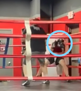
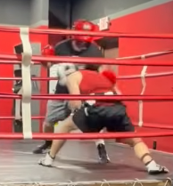
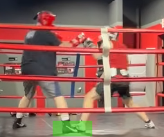

# My First Heavyweight Sparring Session.

I'm still getting over Covid but slowly feeling better. My first time back to the gym after three or four weeks off was last Thursday (11/12/26). I threw up for the first time since my first class. Rico asked me if I was hitting the bag or if the bag was hitting me. So I've been trying to get back in shape since then. It's happening slowly just have a lingering cough.

I sparred Friday and Saturday and had the opportunity to spar a heavy weight for the first time. This is Eric. He has lost like forty pounds since starting boxing. He is so nice and encouraging. I look forward to sparring him again soon.

<iframe
  width="315"
  height="560"
  src="https://www.youtube.com/embed/V23zFw-r7lE"
  title="First Spar with Heavy Weight"
  frameborder="0"
  allow="accelerometer; autoplay; clipboard-write; encrypted-media; gyroscope; picture-in-picture; web-share"
  allowfullscreen>
</iframe>

## My Analysis 🤓
Last post I mentioned these two goals. And I think I did a good job of this. 

1. When you are getting overwhelmed don't put your head down! You can't see what punches are coming and that is dangerous.

2. I need to use my legs when I roll. Got to get down low. 

Now that being said, I was incredibly clumsy. Even slipping completely. This happened because my coach encourages me to step on or over the opponents foot when their right foot is in front. I did this, but Eric is so strong he just moved his foot and took me with him. I don't think I'll be doing it again.

## Going Forward
The biggest lesson though, is *I need to work on my cardio* I'd really struggle to do a two minute round. And back to back rounds right now seem impossible. I think that my conditioning is the real limiting factor in implementing all the things that Joseph and I work on. Don't want to let him down. That means road work. Goal this going forward (on top of regular boxing classes) is to do a 2-3 mile run Tuesdays, and hill sprints Thursday. Wish me luck. Thanks again Eric. You rock. 