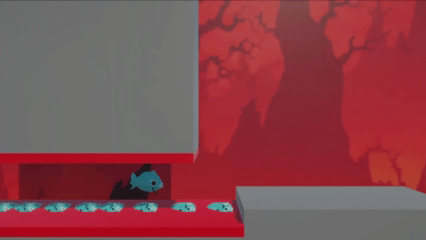

# The making of *Chudly Dies (Again)*

This weekend I had the opportunity to compete in the GDSC Fall 2026 game jam. I learned a lot, met a bunch of interesting and talented people, and overall had a great time. While many teams registered for the jam, nine teams (including ours) completed a game for the competition. The theme was "loop," and it was cool to see how each team tackled the theme in different ways.

If you are interested in trying the game we made, you can [play in your browser here!](https://truelop-give-me-username.itch.io/amphibious-horror)
## Our Game

We spent the first hour after the theme was announced brainstorming ideas. Prior to the jam, the artist and I had talked, and she mentioned wanting to work more on 3D modeling. So we started thinking about what we could make (other than just a 3D game).

We took ten minutes to individually journal and jot down ideas, hoping this would prevent any one person from dominating the conversation and give us more ideas to work with. I came up with eight ideas, but there are a few I'd be interested in revisiting at some point:

1. An F-Zero-style racing game on a Möbius strip. The _loop_ element here would have been the racetrack itself.
2. A music game. Icons representing different sounds could be dragged onto a grid (representing a 4/4 measure with 16th-note subdivisions) to make musical loops (AKA sick phat beats).
3. A side-scrolling platformer where the player ascends a cylinder by _looping_ around it (a la Fez).
4. Some sort of orbit simulation (moons loop around planets, planets loop around the sun). We couldn't think of a gameplay aspect, though, so we didn't go this route.
    

Ultimately, we decided on a different member's idea: a side-scrolling platformer where player would face impossible levels and have to repeat them multiple times, using their corpses as platforms to finish each level. We decided on a horror theme and asked the artist to model whatever excited her.

## Development

Development went smoothly at first. I was able to reuse lots of code (e.g., input controls, commands, states, etc.) from previous projects with small modifications (e.g., changing from an isometric camera to a side-scrolling view).

The biggest pain point for me was getting the animations working. The gameplay required leaving the player's collider and model behind on death, then spawning a new player. For some reason, the freshly spawned players wouldn't animate when they entered the scene. This led me down the dark path of becoming a ChatGPT warrior. I copied and pasted errors and screenshots. Nothing worked. Two hours before the deadline, I learned that if you turn off the Animator, then turn it back on again, it works properly.

I was the only person familiar with Unity, and for the most part, game engines in general. I also consider myself pretty new to them because the game development class I took was two and a half years ago, and I hadn't made many games in between. On the first day, I think the others in my group, besides me and the artist, didn't have much to work on.

On the second, and especially the third day, the person in our group with the least experience really stepped up. I showed him the very basics of Unity and how to use version control. On his own, he was able to find and fix bugs. I wish I'd shown everyone Unity from the start. It would have "cost" us time up front, but I think their own work and learning would have more than made up for it.

## What I Learned

- Copy-pasting AI-generated code, especially when you are learning, **is dumb**. Instead, figure it out yourself, or at the very least, explicitly retype the AI code. I felt compelled to lean on AI bug hunts because of the fast-approaching deadline, but I think debugging could have been faster if I had just fiddled with it enough myself. I should use my human monkey brain.
- Letting artists make stuff **that they want to make** is 💯% the way to go. The best part of our game was the animated fish. The dying animation especially was so, so funny.
- Working in groups is awesome. The best results come from collaboration.
    
## What's Next?

For the last few months, I've been slowly working my way through two game development books: one about [design patterns](https://gameprogrammingpatterns.com/contents.html), the other about [Game AI](https://www.amazon.com/dp/1032033223). (As a quick aside, I find it silly how hard it is to talk about classical AI now because LLMs, deep learning, etc., have taken over so much of the zeitgeist.)

I think that _Chudly Dies (Again)_ did a great job of incorporating the _State_ and _Command_ patterns, as well as avoiding the _Singleton_ pattern (as the authors suggest). I want to do a project that puts the _Flyweight_, _Observer_, and _Prototype_ patterns to better use. I've made small demos (saving those for another post), but it would be nice to do something more substantial, especially with the *Flyweight* pattern now that I've made my first 3D game.

Our game didn't have sound! We had a developer implement sound in the sample scene but ran out of time to put it into the actual game. I think it would be fun to revisit the music-loop project as a way to learn about that aspect of Unity.

I'd also like to get a little bit better at version control. I'm a lot better than I used to be, but I still rely on AI when it comes to dealing with conflicts.