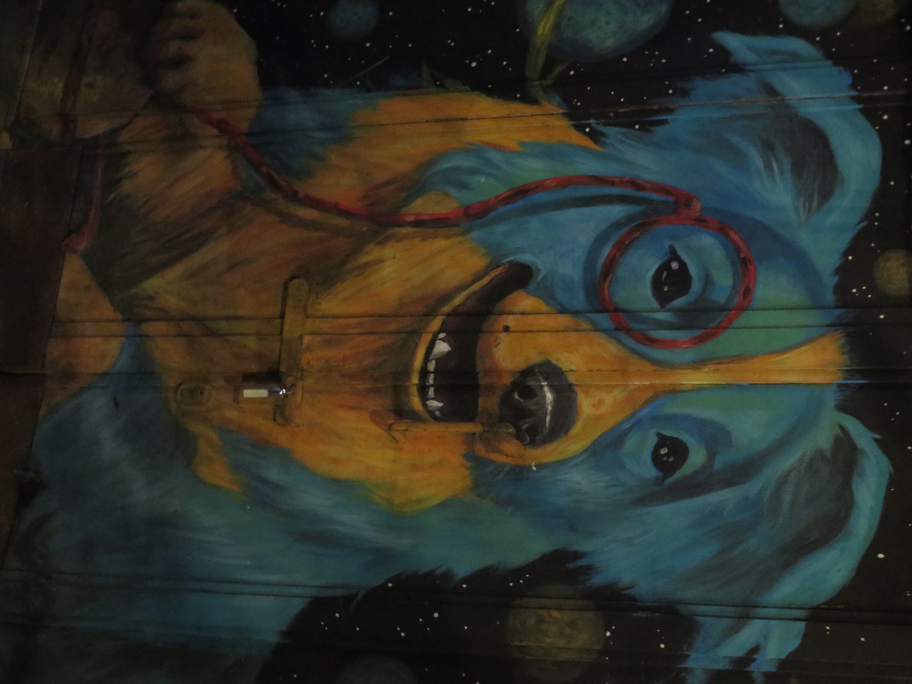
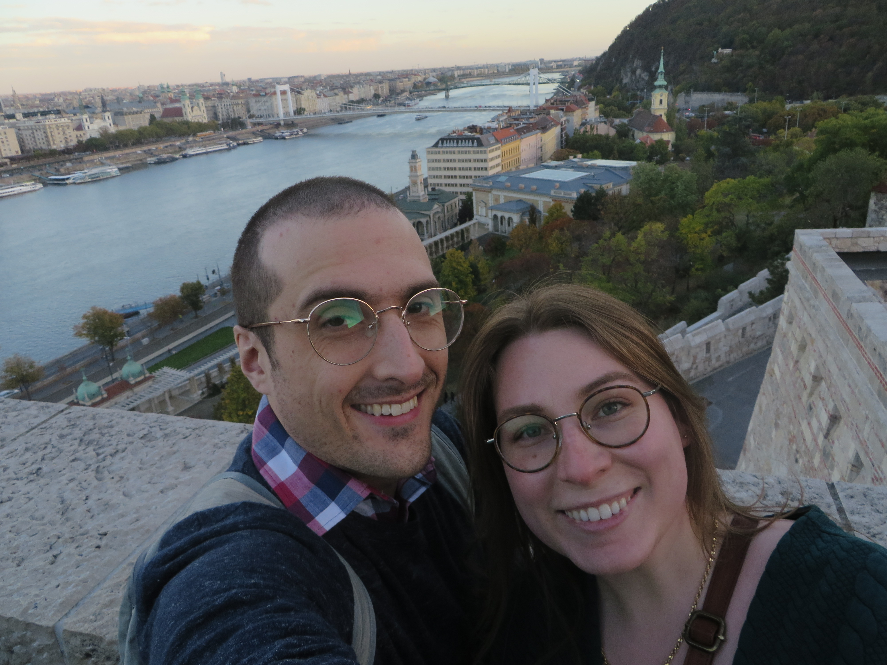

# EMNLP 2026 Reflections on Hungary and AI
I just got back from EMNLP 2026 which was in Budapest. My wife and I are both unfortunately Covid-positive, so I’m writing this feeling under the weather. We came back to very busy lives and being sick, of course, does not help.   

Was it worth it though? Absolutely. Budapest was amazing and I learned so much at the conference. In this blog, I will attempt to do a bit of everything (e.g., reflect on Hungary, talk about trends in NLP research, personal reflections on the changing times, etc.)

## Let’s start with Hungary. 
What a beautiful country. There is so much history. Of course, there is history everywhere, but in Hungary, so much of it is still visible. As a comparison, the United States is only 250 years old, and much of the culture, history, and artifacts of the peoples who lived there before European settlement were destroyed or displaced during the "great" westward expansion. Hungary, on the other hand, has endured for centuries. The buildings are eye-candy. Lushes old buildings with mind-bending architecture. There isn’t anything quite like it in the states. Also, the public transportation was also incredibly easy to navigate. This was my first time in Europe and I was really impressed. 

That said, I've never felt more patriotic about the United States than when it comes to free water, ice, and the ability to find a public bathroom.

The highlight of our trip as a tourist was the sight-seeing package we purchased. It included a Chicos performance in the Puszta Horse Show and a guided tour of Kecskemét. To keep things brief, I’ll include pictures limit my discussion here. 

  
  
  
  
  
  
  

## The Conference. 
I learned so much. Let's split it into subsections
### The First Keynote
In the opening ceremony the keynote speaker, Pascale Fung, divided NLP/CL research into four major eras, and suggested a throughline for the era we are in today (I'm simplifying a bit here, but I think capture the main idea well). 

| Era           | Period      | Main approach                                             |
| ------------- | ----------- | --------------------------------------------------------- |
| Symbolic      | 1950s–1980s | Formal grammars and rule-based systems                    |
| Empirical     | 1990s–2000s | Corpus patterns and statistical models                    |
| Deep Learning | 2010s       | Neural models and probing networks                        |
| LLMs          | 2020s       | General-purpose language models                           |
| Understanding | Now -20??   | Understanding LLMs and using them to study human language |

* **Natural Language Processing (NLP)**: ***Developing*** computational ***systems*** that can process, understand, and generate human language.

* **Computational Linguistics (CL)**: Using computational methods to ***study how human*** language works, including its structure, meaning, and use.

She also emphasized that as the field has evolved, the value (and proportion of the research) of computational linguistics has decreased, while the proportion of papers focused on NLP has advanced. 

Towards the end of her talk -- which I must say, overall I really did enjoy -- Dr. Fung made went seemingly off script and made some statements that caught me off guard. They also received considerable pushback during the Q&A.

> _We need to understand the difference between competence and performance. When a model can outperform humans or another model on some benchmark it doesn’t mean that its intelligence has increased or decreased. Competence and benchmark performance are proxies for intelligence. They’re not exactly the same thing. Even for humans, we have IQ tests and various psychological tests, but they are not the whole picture... They are proxies for understanding human intelligence... For people who argue that language models are conscious, I would say, just show me the evidence. Show me a benchmark for consciousness that works on humans, animals, and LLMs. I have not seen any of that. If you want to work on that, please go ahead, and do it in a scientific way._

I found this statement bizarre for several reasons.

1. She identifies an important problem—distinguishing benchmark performance from underlying competence—but stops short of offering a concrete solution.
2. I found it surprising that a keynote speaker at an A* conference was discussing artificial consciousness at all. What a world we live in.
3. Her argument about consciousness seems particularly strange. She challenges researchers to produce a benchmark that can demonstrate consciousness, but:
    - She acknowledges we can't even do this for human intelligence, let alone consciousness. Does that mean we should question whether humans are conscious?
    - This seems to contradict her earlier call to distinguish competence from benchmark performance. She's almost daring researchers to try to develop precisely such a benchmark for consciousness, 

Overall, why did I find this talk meaningful? For me, it was validating. The research I presented at EMNLP had always felt a bit like the black sheep of NLP research. You can read the [full paper here](https://aclanthology.org/2026.emnlp-main.1676/), but the gist is that we use language models to play a social deduction game with middle schoolers, allowing us to capture and study the middle-schoolers' language, attitudes, and behaviors. Through Dr. Fung's lens, my research was more CL focused which she argued was undervalued and deserved more attention. Pretty cool.
### Random Research I Liked and Trends
I spent a lot of time wandering around the poster sessions, talking to authors, and checking out research that caught my eye. Here are a few highlights:
1. **[Guard Models Are Overconfident Where Base Models Are Uncertain - ACL Anthology](https://aclanthology.org/2026.findings-emnlp.2276/):** This paper shows that training guard models as binary classifiers can make them overly confident in their predictions, even when they shouldn't be. The authors suggest introducing an "unsure" class to help address this.
2. **[Murano: Design, Run, and Reproduce Mechanistic Interpretability Experiments as Composable Pipelines - ACL Anthology](https://aclanthology.org/2026.emnlp-demos.43/):** A package for mechanistic interpretability with syntax similar to Hugging Face Transformers. I'm excited to check this out. It could make interpretability research much easier, more standardized, and more accessible.
3. **[GUI Agents for Continual Game Generation - ACL Anthology](https://aclanthology.org/2026.findings-emnlp.1100/):** Pretty cool idea. One agent develops a game, while another plays it and evaluates it using a rubric (Is it playable? Does it look good? Are there bugs?). That feedback gets passed back to the developer agent, which makes improvements. I asked whether they accounted for "fun," which could make for an interesting follow-up study.
4. **[MemWM: Memory-Augmented Text-Based World Model - ACL Anthology](https://aclanthology.org/2026.emnlp-main.2221/):** I just like this sort of research. I'm not familiar enough with the area to appreciate the paper's specific contribution, but I love text-based games and want to give this one a closer read.
5. **[World Models for Policy Refinement in StarCraft II - ACL Anthology](https://aclanthology.org/2026.emnlp-main.637/):** I loved StarCraft II in high school and still occasionally watch competitive matches. Unfortunately, the author wasn't at the poster when I stopped by, but I'm excited to read the paper.

As for broader trends, and this could just be a reflection of which parts of the venue I wandered through, a few things stood out:

- **Agents. Agents everywhere.** It felt like everyone was working on agents in some capacity.
    
- **Memory and long-context conversations.** Lots of research on what models should remember, what they should forget, and how to manage memory efficiently. One particularly interesting [paper](https://aclanthology.org/2026.emnlp-main.804/) conducted a four-month user study with 40 participants and found that better memory benchmark performance didn't  translate into greater user satisfaction. Remembering information when explicitly asked ("What did I eat yesterday?") is  different from knowing when to naturally use that information ("I don't want to eat anything I've had recently"). User studies rock. Cool work!
    
- **vLLM and grounding LLMs.** There was plenty of work in these areas, although they're not particularly interesting to me (at the moment at least).
    
- **Interpretability.** I'm interested in this area, but I also suspect it's especially vulnerable to AI slop.  To my surprise, my favorite interpretability research was presented by guest speaker Michael Franke during the Language Games workshop (LM Playschool: Improving Language Models through Learning from Dialogue Game Interaction). His talk explored how much language models can infer about the hidden factors behind human communication, such as a speaker's motivations, emotions, and intentions, based on what they say. I plan on reading [his paper]([On Emergent Social World Models — Evidence for Functional Integration of Theory of Mind and Pragmatic Reasoning in Language Models - ACL Anthology](https://aclanthology.org/2026.acl-long.1735/?utm_source=chatgpt.com)) when (sadly) time permits.

### Socializing
Perhaps, the thing I look forward to most when attending conferences is meeting people. The winner of the Dan's-BFF Award this year goes to Dr. Safa Messaoud! Congratulations, you win, well, nothing tangible, just my thanks. 

Safa and I both arrived for registration very early on Sunday expecting a long line. But registration was near instant and we killed the first hour and a half of the conference talking to each other. Beyond that, we just kept running into each other (e.g. on the bus, at the social event where my wife and I sat with her, etc.). She was very friendly, and interesting! I appreciate it when researchers are passionate about their research but are also interesting outside of their careers. 

Safa is originally from Tunisia, got her PhD in the States, and now works as a professor in Qatar. She talked about how she was getting back into the gym and picking up piano again. 

Want to shout out the other great people I met! 
* Nata -- local to Budapest, suggested I read more Brandon Sanderson.
* Dmitrii Khizbullin-- We sat together during the closing ceremony. Very funny.
* Yanick Zengaffinen -- Asked great questions at poster session.
* Yejin and Dahee (and a third, I forgot her name!) -- thanks for letting my wife and I eat dinner with y'all! We had so much fun.
* Alejandra Zambrano -- Thanks for the board game recommendations.
* Oteo Mamo -- We had good chats.
* Philip Müller -- Most likely person I'd call and hang out with if we lived in the same city. He told me he'd go to my poster and he did! And I forgot to go to his! Please forgive me. 
* Many others! If I forgot I'm sorry! This blog is already getting too long! 

### What Place Does Gen-AI Have in the Research Process?
There is a dichotomy when it comes to using LLMs in research. AI has made it easier than ever to submit papers. EMNLP received over 17,000 submissions this year, roughly double that of last year. I suspect a large part of this increase is driven by AI-generated research. I'm not talking about using AI to rewrite a paragraph or suggest an appropriate statistical test. I'm talking about using LLMs to automate the entire pipeline.

I encountered these sorts of papers frequently while reviewing this round, and my peers have shared similar experiences. A few initially left me feeling really insecure. I'd wrestle with a paper for an hour, struggling to understand what the authors were trying to accomplish. Then I'd start noticing things that didn't add up. Numbers in tables wouldn't match those in the text. The methodology wouldn't make sense. Or the paper would be full of complicated language without saying much of anything.

More and more, a scientist's job seems to be as much about communicating research as uncovering new knowledge, yet the slop isn't limited to papers. At the conference,  presenters would read verbatim from AI-generated slides. Even worse, during Q&A sessions, some presenters would ask audience members to repeat their questions, record them, wait a few seconds, and then read back AI-generated answers.

A friend and coauthor of mine, John Schneider, compared AI slop to celebrities getting plastic surgery: "Okay, that is certainly a thing you can do, I guess. But... why?" We need to ask ourselves what we want our science to look like. And why we want it to look that way. 

I do not envy the ARR editor in chiefs. They have a herculean job of keeping our community afloat. There are nasty pragmatics to consider. What I appreciate most about my time with them was their transparency, their work ethic, and their dedication to good quality research. Figuring out how to fairly keep slop out of our science isn't an easy task, but after meeting them, I remain hopeful. 

Making matters worse, the explosion in submissions puts enormous pressure on reviewers. Reviewing papers is already time-consuming, and it's not uncommon to suddenly find yourself responsible for eight or twelve submissions. So, naturally, some reviewers turn to AI. At the conference, I told another researcher that I don't use AI to write my reviews. Her response was, "Wow, how ethical of you." Apparently, writing your own reviews is noteworthy now.

So we have this weird cycle. AI makes it easier to produce papers, which leads to more submissions, which puts more pressure on reviewers, who then use AI to review those papers. We are doing this to ourselves!

Where do we draw the line? When is AI helping us **do better** research, and when is it just helping us **produce more** research?

There are efforts to address these problems, including stricter desk rejections, policies surrounding AI-generated reviews, and attempts to reduce the number of low-quality submissions. I appreciate that the community is taking these issues seriously.

In the music community, teacher's offer their students this advice:

> Student: "How can I play faster?"
>
> Teacher: "Practice slower."
>
> Student: "What?"
>
> Teacher: "Slow is fast, and fast is slow."

Maybe academic research could benefit from slowing down a little. Fewer papers, more time spent thinking, and more careful reviewing. 

Or maybe that is too optimistic. With craziness like the [Huggingface hack]([OpenAI rogue agent breach of Hugging Face - Wikipedia](https://en.wikipedia.org/wiki/OpenAI_rogue_agent_breach_of_Hugging_Face), and AI's recent [dominance in mathematics]([List of mathematical discoveries made with artificial intelligence - Wikipedia](https://en.wikipedia.org/wiki/List_of_mathematical_discoveries_made_with_artificial_intelligence)),  we see how dangerous and how useful this technology can be. 

### Closing Thoughts

On our way to Budapest, my wife and I met a woman at the London airport who worked at Pixar. There had been recent layoffs (she said due to AI), and she was worried about her job security. She was good at her job, but she didn't feel that was enough anymore.

She asked what I did, and I told her I was an AI researcher. The mood shifted pretty quickly. I tried explaining that my current research focuses on making language models safer for children, but I got the impression that she'd already decided I was one of the bad guys.

I want to be one of the good guys.  But I also understand where she's coming from. I don't know what job security looks like for anyone anymore. And I don't think AI researchers are exempt from that uncertainty.

Look at what's happening in mathematics. [3Blue1Brown recently released a video](https://www.youtube.com/@3blue1brown) discussing the future of mathematics in the age of AI. He argues that there's never been a better time to become a mathematician. AI can help researchers solve problems faster and spend more time developing theories and asking interesting questions.

But one comment offered a different perspective. The commenter compared mathematics and programming to craftsmanship:

> Imagine a leather workman who's life passion is making insanely high quality handbags... And then not gradually, but almost overnight someone comes to his door and tells him we can make bags 50 times better than you at 1/tenth the price. But don't you worry, you can make more money overseeing the factory, or selling people on how good this bag is, and explaining that to them... A craft I enjoy doing has been taken away from me, I should be allowed to mourn, I don't care that I can do something else since I never liked doing it in the first place.

I relate to that sentiment.

What gives me hope is the community of researchers I met at EMNLP. I met so many people who genuinely love their work. People who enjoy asking questions, figuring things out, and sharing what they've learned. Despite all my complaints about AI slop, I left feeling optimistic about the people working in this field.

We have some say in what our field becomes. But only if we're willing to take responsibility for it. That means:
1. Producing substantive research.
2. Reviewing each other's work **ourselves**.
3. Rejecting papers that don't meet **our** standards.
4. Communicating our findings **ourselves**.

Otherwise, we risk giving up the very parts of research that made us want to become researchers in the first place. Do we want to be managers on a conveyor belt inspecting the quality of assembly-line papers? Or do we want to hold the power to ask and answer the questions?